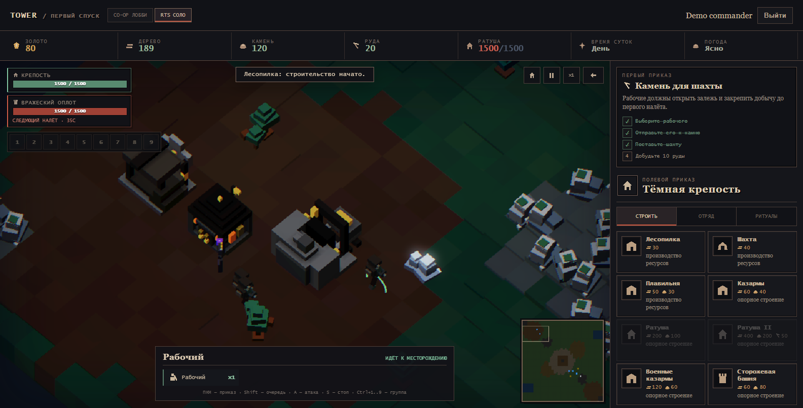
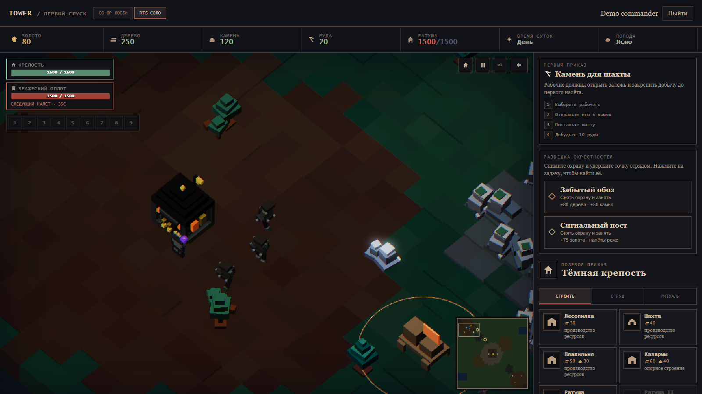
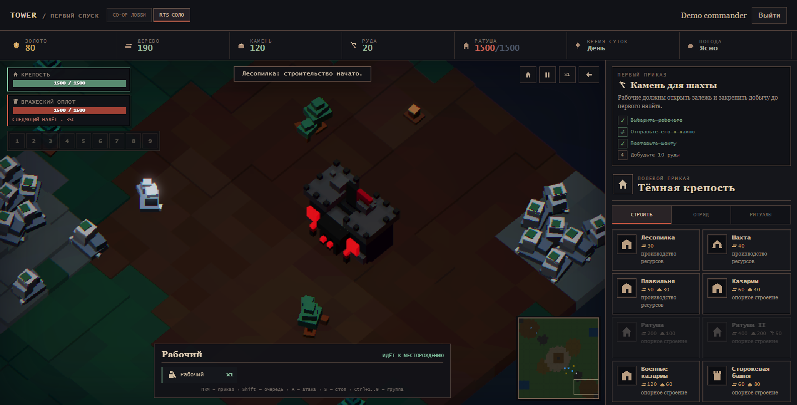
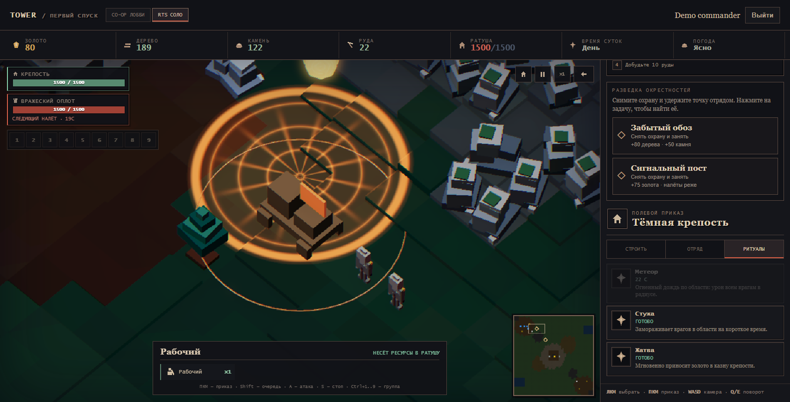
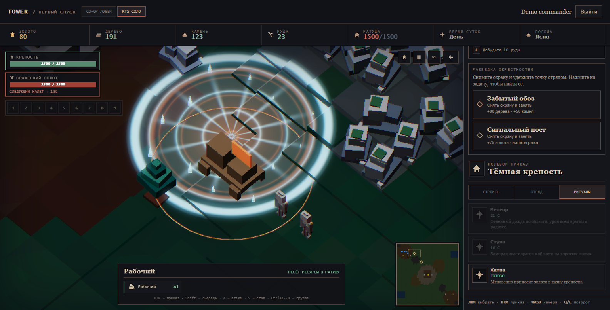
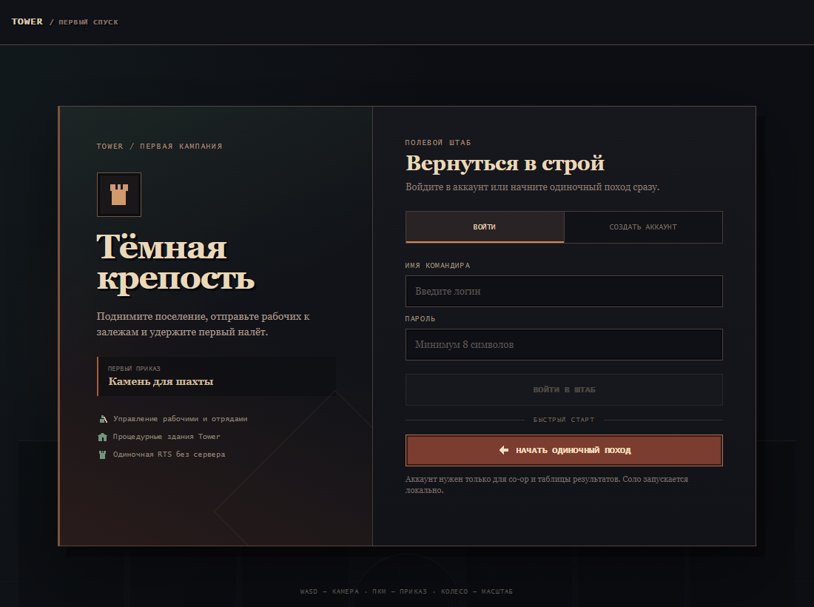

# Tower Engine — voxel RTS showcase



Tower — модульный TypeScript/Babylon.js-движок для детерминированных игр на воксельных сценах. Текущий вертикальный срез — одиночная RTS «Тёмная крепость»: экономика, строительство, производство войск, формации, командирские заклинания и волны противника работают на общей симуляции движка.

## Что показывает RTS

- ортографическую RTS-камеру с плавным WASD/edge-scroll, drag-pan, zoom-to-cursor и вращением;
- чанковый террасный terrain с отдельными биомами, высотами и непроходимыми зонами;
- процедурные составные воксельные здания, войска и ресурсные узлы;
- сбор дерева/камня/руды, производственные цепочки и строительство;
- выделение отрядов, control groups, формации, fog of war и миникарту;
- карточку состава выбранного отряда и цветное подтверждение приказов прямо на поле;
- обход препятствий рабочими и войсками, доставку груза к краю ратуши и стабильную анимацию составных ригов;
- охраняемый обоз с ресурсами и сигнальный пост: очистка, удержание, награда и снижение частоты налётов;
- охрану точек, патрули и налётчиков, вступающих в бой с отрядами игрока вместо движения по единственному TD-маршруту;
- круговую область заклинаний, падение метеора с отложенным уроном и шейдерную стужу на террасном рельефе;
- адаптивный полевой HUD без отдельного «мобильного» режима;
- детерминированную симуляцию, пригодную для prediction/rollback и сетевого режима.









## Визуальная база

Читаемость силуэтов и назначение построек сверялись с CC0-наборами [KayKit Medieval Hexagon](https://kaylousberg.itch.io/kaykit-medieval-hexagon) и [KayKit Adventurers](https://kaylousberg.itch.io/kaykit-adventurers). В игру не вставлен готовый asset pack: крепость, шахта, лесопилка, юниты и вражеский оплот собраны процедурно через voxel pipeline Tower, чтобы showcase демонстрировал сам движок.



## Запуск без сервера и базы данных

```bash
npm install
npm run dev:rts
```

Откройте `http://127.0.0.1:5173/?demo=rts&map=rts-2p-crossroads`. Маршрут создаёт локального demo-командира и сразу запускает RTS, поэтому PostgreSQL, Redis и авторизация для showcase не нужны.

Управление: `WASD`/стрелки или края экрана — перемещение, колесо — zoom-to-cursor, средняя кнопка или `Alt` + ЛКМ — drag-pan, `Q`/`E` — поворот, `1–9` — группы, ПКМ — приказ.

## Структура движка

```text
packages/voxel-core       renderer-independent voxel geometry and meshing
packages/engine-terrain   height contracts, grid navigation and local spacing
packages/engine-scene     scene recipes and validation
packages/voxel-babylon    Babylon.js voxel adapter and articulated character rigs
packages/scene-babylon    Babylon.js scene adapter and terrain-aware spell shaders
shared                    deterministic game simulation and maps
client                    RTS presentation, input and HUD
```

## Проверка

```bash
npm run typecheck
npx tsx scripts/smoke-rts.ts
npx tsx scripts/smoke-rts-solo.ts
npx tsx scripts/smoke-rts-m8.ts
npx tsx scripts/smoke-rts-camera.ts
npx tsx scripts/smoke-rts-terrain.ts
npx tsx scripts/smoke-rts-gameplay.ts
npx tsx scripts/smoke-rts-workers.ts
npx tsx scripts/smoke-rts-rendering.ts
npm run smoke:rts:browser
npm run build
```

Сделать свежий README-кадр. Команда сама соберёт engine-пакеты, временно
поднимет локальный Vite и освободит порт после снимка:

```bash
npm run capture:rts
```

`voxel-lab` остаётся экспериментальной площадкой движка. Ритуальная сцена намеренно не включена в RTS и будет продолжена после завершения игрового RTS-среза.
