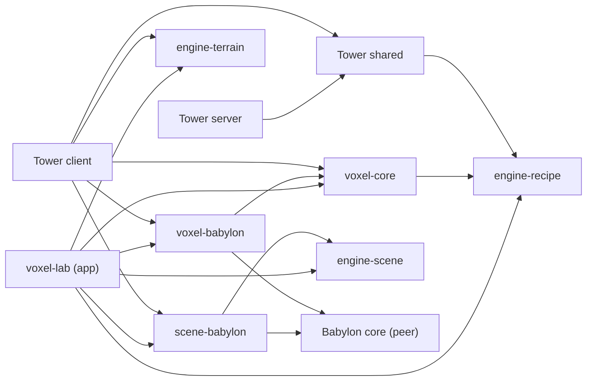

# Tower → Voxkera: аудит зависимостей и границы переноса

> Исторический отчёт этапа 0, предоставленный перед изменением границ. Последующая миграция описана в [результате и проверках](voxkera-migration-status.md). Список ниже относится к исходному checkout; текущий движок находится в соседнем `Voxkera`.

Дата: 26 октября 2026. Рабочая копия: `D:\projeckt\Tower`.
HEAD: `26b3a757afb9b3f887c57cb0266c7af29d37b35d`.

Это **этап 0: отчёт перед переносом**, согласно требованию сначала предоставить зависимости и точный состав модулей. Миграция, переименование пакетов, настройка нового CI и переключение Tower на tarballs в этом этапе ещё не выполнены. Изменения этого этапа — этот документ, `scripts/audit-engine-dependencies.cjs` и его результат `docs/sciens/voxkera-dependencies.json`. Геймплей и renderer не изменялись. Предлагаемый отдельный репозиторий: `D:\projeckt\Voxkera` (пока не создан).

Рабочая копия изначально была dirty: в ней уже находились character assets, изменения public API, удаления ritual-модулей из engine-scene, exporter и CI. Аудит учитывает рабочие файлы, включая untracked, а не только HEAD. Эти изменения сохранены; результаты предыдущего checkout из истории не считаются проверкой этого checkout.

## 1. Результат

Безопасное ядро укладывается в **шесть пакетов** с сохранением нынешних названий после замены scope на `@voxkera`. Создавать ECS, новый renderer или новый backend для этого не требуется.

Из 51 TypeScript-модуля шести библиотек:

- **45** относятся к engine; перенос сохраняет алгоритмы, меняет package imports и barrels.
- **3** смешивают алгоритмы и оформление; их нужно разделить до переноса.
- **3** содержат игровые модели/каталоги; остаются в Tower.

Production-граф библиотек ацикличен. Импортов из engine `src` в shared/client/server/voxel-lab нет. Но присутствуют обратная demo-зависимость, 14 обходов API в тестах и игровые знания внутри voxel-core. Простое копирование `packages/*` закрепит эти дефекты в новом репозитории.

## 2. Как получена карта

Запуск анализатора: `node scripts/audit-engine-dependencies.cjs` из корня Tower. После миграции он пишет `voxkera-dependencies-current.json`; исходный `voxkera-dependencies.json` сохранён как снимок до переноса и не перезаписывается.

TypeScript AST анализирует 268 файлов и 1315 зависимостей: import, export-from, literal dynamic import/require, import-type, script-блоки Vue. Для логического графа package imports сопоставлены с `src/index.ts`; это **не утверждение**, что runtime импортирует исходники. Runtime entrypoints отдельно проверены в manifests и через внешний npm consumer.

JSON содержит каждую дугу с файлом и строкой, runtime-консервативный/type-only признак, manifest-граф, SCC, обходы package API и SHA-256 каждого из 51 engine-кандидатов. Не найдено неразрешённых локальных импортов. Type-only определяется синтаксически: обычный импорт типа без `type` консервативно считается value. Ресурсы, строки с генерируемым кодом, произвольная runtime-инъекция и содержимое JSON/assets требуют отдельной проверки. В частности, чтение Tower fixture в demo выявлено вручную.

## 3. Карта workspace-зависимостей

Стрелка означает «импортирует». Числа — количество import/export declarations через границу workspace, а не число символов.

| Workspace | Зависимости из production src (value / type-only) | Внешние runtime-зависимости и роль |
|---|---|---|
| `packages/engine-recipe` | нет workspace-зависимостей | `zod@4.6.7`; recipe IR, compiler, character schema/validation |
| `packages/engine-terrain` | нет | grid/height math, navigation, separation |
| `packages/engine-scene` | нет | scene contracts, validation, fragments, nav rasterization |
| `packages/voxel-core` | engine-recipe **1 / 3** | voxel geometry, assets, animation; также игровой контент, см. ниже |
| `packages/voxel-babylon` | voxel-core **7 / 3** | peer `@babylonjs/core@7.54.3`, такой же devDependency |
| `packages/scene-babylon` | engine-scene **1 / 1** | peer `@babylonjs/core@7.54.3`, такой же devDependency |
| `packages/voxel-lab` | engine-recipe **2 / 0**, engine-terrain **1 / 0**, engine-scene **2 / 1**, voxel-core **6 / 4**, voxel-babylon **7 / 0**, scene-babylon **1 / 0** | Babylon 7.54.3; Vite demo/editor app, не engine-библиотека |
| `shared` | engine-recipe **1 / 0** | Tower types, maps, catalogs, networking contracts; recipe compatibility facade |
| `client` | shared **8 / 61**, voxel-core **14 / 0**, voxel-babylon **4 / 0**, engine-terrain **3 / 1**, scene-babylon **1 / 0** | Vue, Pinia, Babylon core/loaders 7.54.3; Tower simulation, UI, renderer integration |
| `server` | shared **5 / 8** | Fastify, websocket, PostgreSQL, Redis, dotenv; Tower backend |

`client/package.json` также объявляет engine-scene, но прямых production imports в него сейчас нет. Проверка manifest-графа учитывает это ребро. Сервер не импортирует client simulation: `server/src/realtime/server-sim-loop.ts` принимает `simFactory`/`AuthoritativeSim`. Не переносить simulation в engine в рамках этой работы.



## 4. Циклы, обратные связи и обходы

1. **Manifest dependencies:** циклов нет. **Production src workspace-граф:** циклов нет. **Value file-граф:** циклов нет в пределах описанного статического анализа.
2. **Demo-цикл на уровне пакетов:** `engine-recipe/demo/compile-demo.ts:9` → `voxel-core/src/index.ts` → engine-recipe. Это undeclared dependency и обратная зависимость слоя compiler от реализации stamp provider. Это не замкнутый runtime file-cycle: из core нет обратного пути в demo. Унести demo в `examples/recipe` вне библиотек и использовать public imports. Не добавлять core в dependencies recipe.
3. То же demo на строке 12 читает `client/public/recipes/test-smelter.json`. Это скрытая data-зависимость от Tower, не import edge. Нужен собственный маленький fixture в examples, а не экспорт client assets целиком.
4. **Типовая самоссылка:** `shared/src/types/sim.ts:196` использует `import('../types/sim.js').DamageType` из того же файла. Она стирается при сборке; к миграции engine не относится. Не менять gameplay/types ради чистого отчёта о циклах.
5. **14 прямых импортов engine src из 9 smoke-файлов** перечислены ниже. Production client/shared/server и voxel-lab уже используют package APIs; но это локальные npm workspace links, а не независимые npm-артефакты. После переноса все внешние smoke-тесты должны проверять те же tarballs, что установлены в Tower.

| Файл в `scripts/` | Строки | Что заменить public import |
|---|---|---|
| `smoke-hybrid-scene.ts` | 6, 15 | engine-scene, scene-babylon |
| `smoke-rts-gameplay.ts` | 2, 3 | engine-terrain, voxel-core |
| `smoke-rts-rendering.ts` | 6, 7 | scene-babylon, voxel-babylon |
| `smoke-rts-workers.ts` | 9 | engine-terrain |
| `smoke-voxel-mesh-to-voxel.ts` | 13 | voxel-core |
| `smoke-voxel-stage.ts` | 10, 11 | voxel-core, voxel-babylon |
| `smoke-voxel-surface.ts` | 6, 7 | voxel-core, voxel-babylon |
| `smoke-voxel-traversal.ts` | 2 | voxel-core |
| `smoke-voxel-winding.ts` | 10 | voxel-core |

6. **Семантические обратные связи внутри core:** `VOXEL_BUILDERS` знает `unit:worker`, `building:town-hall`, relics и конкретные модели; `dark-palette` знает tower IDs и enemy categories; kit содержит конкретные головы, оружие и humanoid assembly rules. Отсутствие импорта shared не делает этот код универсальным.
7. `client/vite.config.js` имеет alias только для **Tower shared → shared/dist/index.js**. Это допустимая внутриигровая связь. Для Voxkera не добавлять aliases на sibling `src`, `dist` или tsconfig paths. `shared` пока экспортирует types из `src/index.ts`; это контракт Tower, не engine. Его исправление не является условием выделения Voxkera.

## 5. Точный список переносимых модулей

Во всех списках ниже пути относительны текущему Tower. Каталог назначения — одноимённый `packages/<package>/src` в `D:\projeckt\Voxkera`. Все 45 файлов присутствуют в JSON с исходными хешами. `index.ts` переносится как public barrel, с исключением игровых exports и заменой scope; это не обещание копирования byte-for-byte.

| Исходный каталог | Переносимые файлы | Количество |
|---|---|---:|
| `packages/engine-recipe/src/` | `character-schema.ts`, `character-validate.ts`, `compile.ts`, `errors.ts`, `index.ts`, `place.ts`, `types.ts`, `xorshift32.ts` | 8 |
| `packages/engine-terrain/src/` | `grid-math.ts`, `index.ts`, `navigation.ts` | 3 |
| `packages/engine-scene/src/` | `fragment.ts`, `index.ts`, `nav-grid.ts`, `random.ts`, `types.ts`, `validate.ts` | 6 |
| `packages/scene-babylon/src/` | `area-effects.ts`, `index.ts` | 2 |
| `packages/voxel-babylon/src/` | `character-asset-rig.ts`, `character-material.ts`, `character-rig-handle.ts`, `character-template.ts`, `index.ts`, `rig.ts`, `voxel-geometry.ts`, `voxel-material-mesh.ts`, `voxel-stage.ts` | 9 |
| `packages/voxel-core/src/` | `character-animation.ts`, `character-animator.ts`, `character-asset.ts`, `index.ts`, `rig-motion.ts`, `types.ts`, `voxel-greedy.ts`, `voxel-helpers.ts`, `voxel-io/vox-importer.ts`, `voxel-io/vox-writer.ts`, `voxel-masonry.ts`, `voxel-material-geometry.ts`, `voxel-parts-types.ts`, `voxel-sdf.ts`, `voxel-solid-voxelization.ts`, `voxel-traversal.ts`, `voxel-visualhull.ts` | 17 |

Отдельно, **три mixed-модуля** в `packages/voxel-core/src/`:

| Модуль | В Voxkera | В Tower |
|---|---|---|
| `dark-palette.ts` | `shade`, `desaturate` → `voxel-core/src/color.ts`; type-only RGB imports перевести на `types.ts` | `PALETTE`, `ACCENT`, `enemyEye`, `towerBase`, `towerAccent`, `relicAccent` → `client/src/babylon/voxel/content/dark-palette.ts` |
| `voxel-palette-core.ts` | алгоритмы поиска/вариаций и `PALETTE_MAX` → `voxel-core/src/palette.ts`, palette/label map/fallback передавать явно | исходные entries, indexed palette и совместимые функции с прежними сигнатурами → `client/src/babylon/voxel/content/indexed-palette.ts` |
| `voxel-stamps/voxel-stamps.ts` | геометрия stamp, `StampEntry`, `StampResult`, registry, `assembleRecipe`; palette/material resolver и default colors сделать параметрами | прежний `materialColor` и конфигурация defaults → `client/src/babylon/voxel/content/stamp-materials.ts`; wrapper создаёт registry с прежними цветами |

Геометрические defaults и animation constants сохраняются. При параметризации цветов Tower wrapper обязан воспроизводить нынешний порядок палитры, fallback, float-значения и voxel arrays. Изменение внешнего вида не входит в этап разделения. Сначала фиксировать детерминированные значения/хеши нынешних builders, palette и kit seeds, затем сравнивать после разделения. Это проверяет результат переноса данных, а не структуру реализации.

**Три целых модуля остаются в Tower**, перемещаясь из нынешнего core в game-owned content:

- `packages/voxel-core/src/voxel-builders.ts` → `client/src/babylon/voxel/content/voxel-builders.ts`, включая весь `VOXEL_BUILDERS` и `builderEmissive`.
- `packages/voxel-core/src/voxel-kit/parts-library.ts` → `client/src/babylon/voxel/content/parts-library.ts`.
- `packages/voxel-core/src/voxel-kit/kit-assembler.ts` → `client/src/babylon/voxel/content/kit-assembler.ts`.

Существующие client facades `voxel-builder.ts`, `voxel-parts.ts`, `dark-palette.ts`, `voxel-palette.ts`, `procedural-kit/*` сохранить как compatibility layer: они будут явно экспортировать нужные engine APIs и локальный content. Не реэкспортировать Tower content из Voxkera и не создавать циклическую зависимость core → game-content → core.

## 6. Остальная классификация

| Область | Решение для первой миграции |
|---|---|
| `shared/src/types`, `catalogs`, `maps` | game-specific; остаются, включая costs, spells, buildings, terrain tiles, snapshots и protocol |
| `shared/src/recipe/index.ts` | остаётся game compatibility facade, меняется только import на собранный `@voxkera/engine-recipe` |
| `client/src/sim/**`, `domain/**`, UI/stores/services/composables | остаются; engine использует структурные Grid/Vector contracts, не Tower types |
| `client/src/babylon/{units,enemies,towers,relics,resources,walls,projectiles}/**`, `world-sites.ts`, `createScene.ts`, `game-loop.ts`, `level-renderer.ts`, `asset-catalog.ts` | Tower integration и content; остаются |
| `client/src/babylon/terrain/{rts-terrain,rts-scenery,tile-renderer,chunked-voxel-field,terrain-math}.ts`, `rtscam.ts` | остаются: включают Tower contracts/настройки и требуют отдельной стабилизации API. Не расширять перенос ради слова engine |
| `client/src/babylon/voxel/importers/{manual-parts,unit-rigs,enemy-rigs}.ts` | модели Tower; остаются |
| client voxel compatibility facades | остаются маленькими game-facing facades над package API |
| `voxel-toon`, `voxel-debris`, `gltf-parts`, `lod`, `picking`, `perf-monitor`, `pixel-art/**`, `atmosphere` | потенциально переиспользуемые utilities/adapters, но **отложены**; не нужны для отделения уже выделенного ядра |
| `packages/voxel-lab/**` | demo/tool app; в первой миграции остаётся в Tower и проверяет внешние packages. Нынешние fantasy kit/model сцены остаются с Tower content. Отдельный нейтральный `examples/character` в Voxkera переносится позже выборочно |
| `packages/voxel-lab/src/fixtures/{ritual-caster,ritual-sanctum,procedural-sanctum}.ts` | demo content, не public API engine; не возвращать в engine-scene |
| `server/**` | целиком Tower; database, auth, rooms, matchmaking и networking не переносить |
| `client/public/**`, `.env*`, БД/дампы, записи и screenshots | не включать в engine repository или npm tarballs |

В дополнение к исходникам: скопировать manifests и tsconfigs шести библиотек с изменениями ниже, имеющиеся README; добавить отсутствующие package README. `engine-recipe/skills/tower-assets/**` пригоден как authoring documentation только после обновления имён/import examples и проверки starter JSON; не считать его runtime-модулем. Tower `.git`/полный `source-history.bundle` не копировать в новый репозиторий. Для происхождения достаточно manifest с source revision, путями и хешами; фильтрация истории — отдельная задача.

## 7. Пакеты и public API

| Новый пакет | Internal dependencies | Public область |
|---|---|---|
| `@voxkera/engine-recipe` | нет; runtime `zod@4.6.7` | RecipeV3/IR, compile/loadRecipe, diagnostics, CharacterRecipeV1, schema/validation/loadCharacterRecipe |
| `@voxkera/engine-terrain` | нет | GridData/Vector3Data, conversions, heights, GridNavigator/findNavigationPath/separation |
| `@voxkera/engine-scene` | нет | SceneKitSpec/материалы/коллайдеры, validation, fragment composition, nav grid |
| `@voxkera/voxel-core` | engine-recipe той же точной версии | voxel/rig types, geometry/SDF/IO/stamps, character compiler, animation, rig motion, generic color/palette algorithms |
| `@voxkera/voxel-babylon` | voxel-core той же точной версии | mesh upload/builders, rig assembly/clone/dispose, character templates/instances/materials, stage |
| `@voxkera/scene-babylon` | engine-scene той же точной версии | buildSceneKit, options/handle, AreaEffectRenderer |

Порядок сборки: recipe → terrain → scene → voxel-core → voxel-babylon → scene-babylon (независимые ветви можно менять местами). Internal versions — обычный npm semver, например `0.1.0`, не `file:../src` и не `workspace:*`. Root monorepo `private: true`, `workspaces: ["packages/*"]`, `packageManager: "npm@11.6.2"`, lockfile; TypeScript/tsx явно заданы в devDependencies нового root. Сейчас Tower root заявляет yarn при наличии npm lockfile; исправление этого конфликта включить в инфраструктурный этап.

В первом внешнем релизе использовать только корневой export `.` каждого пакета. Не публиковать wildcard `./src/*`/`./dist/*`. Старые barrel reexports core из Babylon adapter можно временно сохранить для совместимости; **игровые exports исключить**. Internal implementation types должны резолвиться внутри dist и не требовать исходного workspace. Зафиксировать список exported symbols и их type signatures на этапе public API; не объявлять все implementation-функции новым обязательством совместимости.

Шаблон package contract (пример adapter; это спецификация следующего этапа):

```json
{
  "name": "@voxkera/voxel-babylon",
  "version": "0.1.0",
  "private": true,
  "license": "UNLICENSED",
  "type": "module",
  "main": "./dist/index.js",
  "types": "./dist/index.d.ts",
  "files": ["dist", "README.md"],
  "exports": {
    ".": {
      "types": "./dist/index.d.ts",
      "import": "./dist/index.js",
      "default": "./dist/index.js"
    }
  },
  "dependencies": { "@voxkera/voxel-core": "0.1.0" },
  "peerDependencies": { "@babylonjs/core": "7.54.3" },
  "devDependencies": { "@babylonjs/core": "7.54.3" },
  "scripts": { "build": "tsc", "typecheck": "tsc --noEmit" }
}
```

`scene-babylon` получает тот же Babylon peer. Pure packages не получают Babylon/Vue/DOM как обязательные runtime dependencies. `@babylonjs/loaders` сейчас нужен Tower importer, а не этим двум adapters. Не расширять peer range до `^7`/`>=7` без проверки: `character-material.ts` уже содержит локальную коррекцию WGSL именно для 7.54.3. Сохранить её и существующий WebGL путь; нового WebGPU кода не добавлять.

TypeScript: `target: ES2022`, `module/moduleResolution: NodeNext`, `rootDir: src`, `outDir: dist`, `strict: true`, `declaration: true`. Для browser adapters добавить DOM в lib; сохранить `.js` в относительных imports. Сейчас они используют Bundler/ESNext — NodeNext нужно проверить отдельным этапом, не совмещать с изменением renderer. Для переносимых пакетов отключить `declarationMap`/`sourceMap` либо поставлять осмысленные самодостаточные maps; нынешние maps указывают на неупакованный src. Начальная минимальная схема — отключить maps.

Не ставить `sideEffects: false` всем adapters автоматически: в них есть side-effect imports Babylon mesh extensions и shaders. Сначала подтвердить tree-shaking/runtime тестом. `engine-recipe` уже имеет `sideEffects: false`.

Эти правила опираются на [npm package.json: files/private/peerDependencies](https://docs.npmjs.com/cli/v11/configuring-npm/package-json/), [Node package exports](https://nodejs.org/api/packages.html#package-entry-points) и [TypeScript module resolution](https://www.typescriptlang.org/docs/handbook/modules/reference.html). Это проектные решения по документированным механизмам; публикация в npm registry в эту миграцию не входит.

## 8. Tower должен потреблять именно артефакты

Предлагаемый начальный transport — зафиксированные `.tgz` в `Tower/vendor/voxkera/`, без registry и зависимости от наличия sibling repo при `npm ci`.

1. В Voxkera выполнить clean build и `npm pack --workspace <name> --json --pack-destination <staging>` для шести пакетов.
2. Проверить pack file lists и SHA-256, затем скопировать tarballs и manifest в Tower `vendor/voxkera/`.
3. В manifests `client`, `shared`, `packages/voxel-lab` указать `@voxkera/*: file:<относительный путь к соответствующему .tgz>`; пример из `client`: `file:../vendor/voxkera/voxkera-voxel-core-0.1.0.tgz`. Из `packages/voxel-lab` путь имеет ещё один `../`. Установить все шесть tarballs вместе и обновить root lockfile; проверить npm dedupe/одну Babylon instance.
4. Заменить все game-facing imports, включая shared facade и 14 smoke imports. Убрать шесть engine-каталогов из Tower workspaces и root engine-build/typecheck orchestration. `build:pkgs` можно временно оставить как read-only verify-artifacts command для совместимости dev/smoke scripts; он не должен обращаться к sibling и пересобирать engine.
5. Удалять старые engine sources из Tower только после прохождения регрессий с tarballs. Tower root может по-прежнему собирать shared/server/client и содержать lab.
6. Чистая Tower-копия без `../Voxkera` и без шести старых packages должна проходить `npm ci`, typecheck, RTS smokes и build. Проверить resolved package paths: обычные установленные директории, не symlink/junction наружу. Проверить lockfile: нет `link: true` для `@voxkera/*`, нет source aliases и внешних file-directory dependencies.

При следующем обновлении делать новую версию/имя tarball и новый lock integrity. Не заменять содержимое неизменного `.tgz`: иначе локальный npm cache может скрыть изменение. Registry transport можно добавить позже без изменения imports.

## 9. Проверки упаковки и CI

**Уже существует до этого аудита:** dist entrypoints, TypeScript declarations, ESM package type, закрытый exports `.`, exact Babylon peer у adapters, `scripts/smoke-engine-consumer.cjs`, `scripts/export-engine.cjs`, `.github/workflows/engine.yml`. Это полезная основа, но exporter пока копирует packages с `@tower` scope, lab и game content; он не переключает Tower на полученные пакеты.

Новый `smoke:pack` в Voxkera должен:

- Собрать и реально упаковать все шесть пакетов; проверить наличие JS/d.ts, отсутствие src, Tower paths, `.env`, client/server/shared и game-only exports. Проверять и содержимое declarations на старые/обратные imports, не только package.json.
- В изолированной временной папке установить **все tarballs одновременно**, TypeScript и Babylon 7.54.3, без npm workspace links, tsx и paths aliases. Создать минимальный fixture в самом consumer, не копировать Tower warden JSON как обязательный внешний ресурс.
- Проверить обычный Node ESM `.mjs` runtime, а не runtime TypeScript loader: загрузка каждого public entrypoint, recipe compile, character template/animation/disposal через Babylon NullEngine, grid navigation, scene-kit construction/disposal.
- Проверить `.d.ts` consumer для **всех шести** пакетов в NodeNext и Bundler режимах. Пробовать `skipLibCheck: false`; несовместимость declarations Babylon фиксировать явно, не считать прежний тест со `skipLibCheck` полной проверкой типов.
- Убедиться, что `@voxkera/*/src/...` и неэкспортированные `dist/...` закрыты exports. Проверить сборку browser consumer с Vite, чтобы увидеть проблемы shader registration/tree shaking, которых NullEngine не обнаруживает.
- В finally удалять только собственный проверенный sandbox или сохранять его по debug-флагу; не оставлять локальные node_modules, маскирующие чистую установку.

**Voxkera CI:** Node 24, npm 11; Windows + Linux для build/typecheck/pack consumer; root `npm ci --ignore-scripts` по committed lockfile → clean build → typecheck → geometry/character/runtime tests → pack smoke → browser example. Для browser job явно установить Chromium и передать executable через `TOWER_CHROME` либо нейтральный новый env, не полагаться на `C:\Program Files` runner. Browser job обязан запускать собственный сервер на свободном порту и писать testedWorkspace/backend. Выгружать tarballs, pack manifest, тестовые отчёты и failure screenshots. Workflow не имеет publish step, npm token или remote push.

**Tower CI:** сначала validate committed tarballs/integrity/boundaries → `npm ci` → shared build → `npm run typecheck` → все существующие RTS headless smokes → `npm run smoke:rts:browser` с собственным сервером → `npm run build` и текущий bundle budget. Выполнять на чистом checkout, где исходники Voxkera недоступны. Для проверки новой версии artifacts можно использовать отдельный integration workflow с загруженным engine artifact; обязательный Tower CI использует vendored artifacts и не требует соседнего checkout.

`scripts/audit-engine-dependencies.cjs` сейчас — **инвентаризация, не запрещающий CI gate**. На этапе миграции из неё выделить boundary check: engine → game и Tower → engine src должны завершаться ненулевым кодом, production SCC запрещены. Demo/tools не должны маскировать production-циклы и проверяются отдельным правилом.

## 10. Небольшие этапы и критерии завершения

| Этап | Изменение | Проверка перед следующим этапом / откат |
|---|---|---|
| **0 — выполнен** | карта, inventory/hashes, baseline; без переноса | этот отчёт и воспроизводимый JSON |
| **1 — отделить content в Tower** | три game-файла + три mixed-файла, совместимые client facades; удалить обратное demo import | сравнение детерминированных outputs; build pkgs/shared → typecheck → 9 RTS smokes → browser RTS → build. Откат только этого этапа |
| **2 — sibling Voxkera** | создать `D:\projeckt\Voxkera`, npm workspaces/lock, шесть пакетов `@voxkera/*`, API/ESM/d.ts/peers, собственный минимальный example | clean build/typecheck, geometry/character/scene tests, pack consumer; Tower пока работает с прежним способом подключения |
| **3 — pack и CI** | pack manifest, внешний JS/types/browser consumer, CI без публикации | clean install на Windows/Linux, package exports/boundary gates; сохранить проверенные tarballs |
| **4 — Tower как consumer** | vendor tarballs, manifests/lock/imports, 14 smoke imports, root scripts; исключить исходники engine из workspaces | typecheck, все RTS smokes, browser RTS, полный build/bundle budget; проверить без sibling и старых engine sources |
| **5 — завершение** | удалить дубликаты engine, обновить README/dev instructions, зафиксировать provenance и версию artifacts | новый чистый checkout Tower и Voxkera проходит свои CI; diff не меняет gameplay, simulation constants/maps/catalogs |

Не переносить этапы 1–4 одним непрозрачным exporter запуском. Dirty исходный Tower не коммитить целиком автоматически; локальные изменения пользователя не должны попасть в migration checkpoint случайно. Лицензия остаётся `UNLICENSED`, packages private; публикация и удалённый репозиторий не создаются как побочный эффект.

## 11. Проверено в текущей рабочей копии

Среда: Node `v24.13.0`, npm `11.6.2`, Babylon `7.54.3`.

| Проверка | Результат до миграции |
|---|---|
| `npm run build` | PASS: шесть engine packages, shared, server, client; Babylon chunk 2.66 MB при лимите 3.00 MB |
| `npm run typecheck` | PASS: все текущие workspaces |
| `node --import tsx scripts/smoke-rts.ts` | PASS |
| `smoke-rts-camera.ts`, `smoke-rts-gameplay.ts`, `smoke-rts-workers.ts`, `smoke-rts-rendering.ts` | PASS через `node --import tsx` |
| `smoke-rts-terrain.ts`, `smoke-rts-solo.ts`, `smoke-rts-m8.ts`, `smoke-unit-orders.ts` | PASS через `node --import tsx` |
| `node scripts/smoke-rts-browser.cjs <owned-local-url>` | PASS: выбран свободный порт 59121, workspace `D:\projeckt\Tower`; workers/orders/buildings/objectives/spells/camera, три карты, resize/disposal, responsive UI |
| `npm run smoke:engine:consumer` | PASS: шесть нынешних **@tower** tarballs установлены вне workspace; Node runtime и public types проходят |
| AST audit | PASS: JSON с 268 файлами, 1315 дугами, inventory 51 файл; 0 unresolved local imports |

Во время baseline один запуск terrain smoke совпал с `clean-engine-builds` другого теста и завершился отсутствующим dist. После завершения build повторён последовательно: PASS. Это ошибка порядка запуска проверки, не обнаруженная регрессия gameplay. В миграционном CI clean/build и runtime проверки должны выполняться последовательно.

Build выдаёт предупреждения Rollup об аннотациях zod и размере chunk >500 kB; существующий project bundle budget проходит. Полный новый clean `npm ci`, Linux consumer, отсутствие старого engine source tree, CI нового repo и **Tower на @voxkera tarballs ещё не проверены**, поскольку это этапы после отчёта. Character browser/WebGPU gates в этом аудите не перезапускались; старые результаты не выдаются за текущие.
